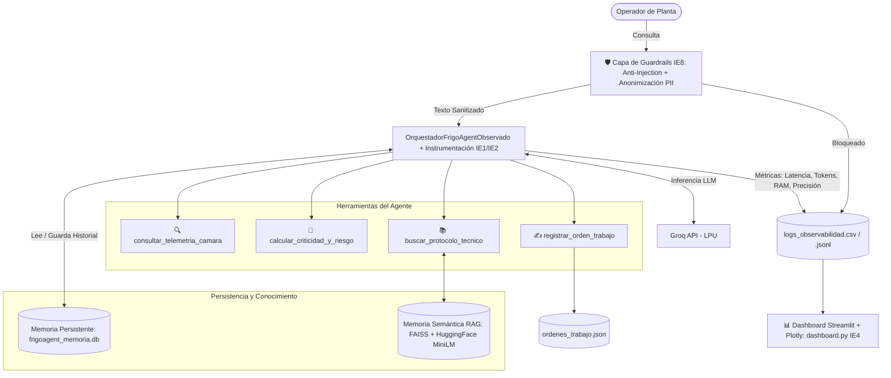

# ❄️ FrigoAgent v2: Observabilidad, Trazabilidad y Seguridad en Agentes de IA

Proyecto desarrollado para la asignatura **Ingeniería de Soluciones con IA (ISY1010)** — **Evaluación Parcial N°3 (Implementación de Observabilidad)**, Duoc UC.

## 📋 Descripción del Proyecto y Evolución (EP2 → EP3)
**FrigoAgent** es un agente autónomo de diagnóstico y gestión de mantenimiento para sistemas de refrigeración industrial. En esta tercera etapa se incorporó una capa completa de **observabilidad, trazabilidad, seguridad y persistencia** sobre el agente desarrollado previamente:

* **Persistencia Real de Memoria (`SQLite`):** Se reemplazó la memoria volátil en RAM por la base de datos local `frigoagent_memoria.db`, garantizando que el historial conversacional de los turnos de planta no se pierda al cerrar o reiniciar el entorno.
* **Métricas de Observabilidad (IE1, IE2):** Instrumentación en tiempo real de precisión de herramientas, consistencia, frecuencia de errores, latencia total (`ms`), consumo de tokens y uso de memoria RAM (`MB`) con `psutil`.
* **Trazabilidad Estructurada (IE3):** Registro automático de cada ejecución y evento en formato tabular (`logs_observabilidad.csv`) y estructurado (`logs_observabilidad.jsonl`).
* **Dashboard Interactivo (IE4):** Panel de monitoreo visual desarrollado en **Streamlit** y **Plotly** (`dashboard.py`).
* **Protocolos de Seguridad y Privacidad (IE8):** Capa de *Guardrails* que bloquea intentos de *Prompt Injection* y anonimiza automáticamente datos personales (PII: RUT chileno y correos electrónicos) antes de enviarlos a la API externa.

## 🏗️ Arquitectura de Observabilidad y Seguridad



## 📁 Estructura del Repositorio
```text
├── evaluacion3_FrigoAgent_Observabilidad.ipynb  # Notebook principal con agente, pruebas y observabilidad
├── dashboard.py                                 # Aplicación web interactiva en Streamlit (IE4)
├── logs_observabilidad.csv                      # Registros de ejecución y métricas (evidencia IE1-IE3)
├── logs_observabilidad.jsonl                    # Logs estructurados por evento
├── ordenes_trabajo.json                         # Tickets de mantenimiento generados por el agente
├── frigoagent_memoria.db                        # Base de datos SQLite con memoria persistente
└── README.md                                    # Documentación técnica e instrucciones de ejecución
```

## 🚀 Instrucciones de Ejecución y Validación

### Parte 1: Ejecución del Agente y Generación de Métricas (Google Colab)
1. Abrir `evaluacion3_FrigoAgent_Observabilidad.ipynb` en **Google Colab**.
2. Ejecutar la **Celda 1** para instalar las dependencias (`langchain`, `langchain-groq`, `faiss-cpu`, `psutil`, `plotly`, `streamlit`, etc.).
3. Ejecutar la **Celda 2** e ingresar una `GROQ_API_KEY` válida (obtenible en [console.groq.com/keys](https://console.groq.com/keys)).
4. Ejecutar secuencialmente las **Celdas 3 a 7** para indexar la base vectorial, correr los 5 escenarios con variabilidad de datos (`ESC-01` a `ESC-05`) y generar los archivos `logs_observabilidad.csv`, `frigoagent_memoria.db` y `dashboard.py`.

### Parte 2: Visualización del Dashboard de Monitoreo (Local con Streamlit)
1. Descargar `dashboard.py` y `logs_observabilidad.csv` en una misma carpeta local.
2. Instalar las librerías de visualización en tu entorno local:
   ```bash
   pip install streamlit pandas plotly
   ```
3. Ejecutar el dashboard desde la terminal ubicada en dicha carpeta:
   ```bash
   python -m streamlit run dashboard.py
   ```
4. Abrir en el navegador la dirección local generada (por defecto `http://localhost:8501`) para inspeccionar KPIs, gráficos interactivos y la tabla de trazabilidad.
